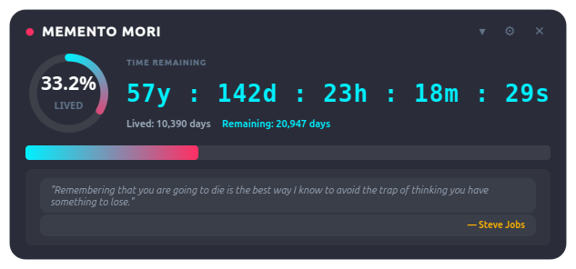
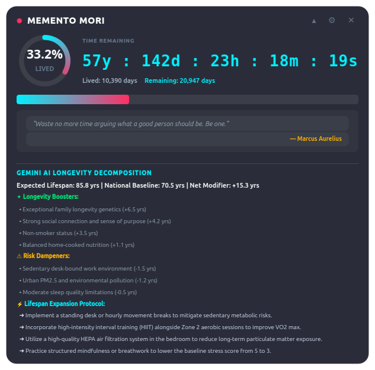
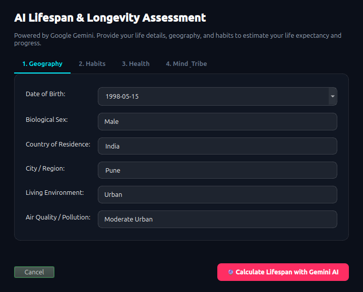

# ⏳ AI Death Clock & Longevity Monitor

An ambient, draggable desktop widget that uses Google Gemini Cloud to estimate biological life expectancy based on actuarial demographics, geography, physical lifestyle, and mental wellbeing factors. Features real-time countdown ticking, circular vector dials, and an AI longevity expansion protocol.

---

## ✨ Features

- **Draggable Glassmorphic Desktop Widget**:
  - Frameless obsidian glass window with neon cyan, rose, and amber accents.
  - Smooth vector-rendered circular progress dial showing percentage of life lived.
  - High-frequency real-time countdown: `Years : Days : Hours : Minutes : Seconds`.
  - Live statistics: Days lived vs Days remaining.
  - Automatically remembers its last desktop position on screen (`widget_config.json`).
  - Right-click context menu: Pin to Top, Expand/Collapse Longevity Protocol, Next Quote, Reassess.

- **Actuarial Life Expectancy with Google Gemini AI**:
  - Automatically queries available free-tier Google Gemini models (`gemini-3.1-flash-lite`, `gemini-flash-lite-latest`, and `gemini-3.5-flash-lite`).
  - Evaluates geographic factors (national baseline expectancy, altitude, urban pollution).
  - Evaluates lifestyle factors (sleep hours/quality, exercise intensity, nutrition, smoking, alcohol).
  - Evaluates mind & social factors (stress score, social cohesion, life purpose/ikigai, genetics).
  - Computes net modifiers, longevity boosters (+X yrs), and risk dampeners (-X yrs).

- **Expandable Longevity Expansion Protocol**:
  - Toggle between minimalist floating HUD mode and an expanded dashboard with actionable personalized recommendations to add healthy years to your lifespan.

- **Memento Mori Philosophical Reflections**:
  - Curated, rotating stoic reflections from Seneca, Marcus Aurelius, and Steve Jobs reminding you to live intentionally.

- **Interactive Multi-Step Questionnaire**:
  - Graphical onboarding wizard and terminal CLI wizard (`--cli`).
  - Easily edit or reassess anytime by clicking the ⚙ icon on the widget.

---

## 🖼️ Previews

| Compact Desktop HUD | Expanded Longevity Protocol |
| :---: | :---: |
|  |  |

| Multi-Step Assessment Wizard |
| :---: |
|  |

---

## 🚀 Quick Start

### 1. Launch the Desktop Widget
```bash
/home/ameya/death-clock/run.sh
```
Or double-click the **AI Death Clock** icon directly on your desktop!

### 2. Re-take the Life Assessment
```bash
/home/ameya/death-clock/run.sh --setup
```

### 3. Run the Terminal Questionnaire
```bash
/home/ameya/death-clock/run.sh --cli
```

### 4. Benchmark & Scan Gemini Models
```bash
/home/ameya/death-clock/run.sh --scan
```

---

## 📂 Project Structure

```
/home/ameya/death-clock/
├── config.py                 # Environment configuration & path resolvers
├── models.py                 # UserProfile & LifespanEstimate data schemas
├── gemini_engine.py          # Gemini cloud client, prompt engineering & model fallback
├── quotes.py                 # Memento Mori philosophical quotes
├── main.py                   # Main entry point and lifecycle manager
├── cli.py                    # Terminal interactive assessment wizard
├── run.sh                    # Shell launcher script
├── gui/
│   ├── styles.py             # Glassmorphic dark design tokens and QSS
│   ├── gauge_widget.py       # Custom QPainter vector circular arc gauge
│   ├── onboarding_dialog.py  # 4-step interactive assessment wizard
│   └── desktop_widget.py     # Frameless, draggable desktop countdown widget
├── data/
│   ├── profile.json          # Persisted life profile and actuarial prediction
│   └── widget_config.json    # Screen coordinates & widget state
└── lib/                      # Bundled X11 cursor libraries
```

---

## ⚙️ Configuration & API Key

The application reads your `GEMINI_API_KEY` from `/home/ameya/death-clock/.env` (cloned securely from `/home/ameya/robot/.env`).
Models scanned and supported:
- Primary: `gemini-3.1-flash-lite`
- Fallback 1: `gemini-flash-lite-latest`
- Fallback 2: `gemini-3.5-flash-lite`
